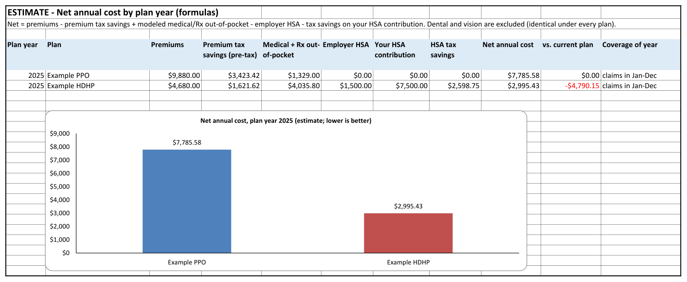

# HSA vs. PPO decision toolkit

Should you switch from your PPO to a high-deductible health plan (HDHP) with a health savings account (HSA)? This toolkit answers that with **your own Cigna claims history** instead of a generic premium-vs-deductible comparison. The analysis tools run **locally on your computer**. If you use the optional [AI assistant skill](#let-an-ai-agent-walk-you-through-it), the conversation goes to that assistant's cloud AI model, and the local tools strip personal details before it sees any results.

1. **[EOB extractor](./cigna_eob_local/README.md) (Phase 1).** Turns myCigna claim-summary CSV exports and Explanation of Benefits (EOB) PDFs into **de-identified** financial CSVs. Outputs are built from an allow-list of fields, designed to keep names, member IDs, providers, drugs, claim numbers and exact dates out. A review step lets you check every doubtful figure, and a leak scan checks the outputs against your original files for common leaks.
2. **[Cost comparison model](./hsa_cost_model/README.md) (Phase 2).** Replays those claims, in order, under every plan's deductible, coinsurance, copay and out-of-pocket rules. It then adds premiums, employer HSA money and tax savings, and writes an Excel workbook: net annual cost, scenarios, break-even, worst case, monthly cash flow and a multi-year projection.

The full requirements are in [PRD.md](./PRD.md).

> [!WARNING]
> **Experimental alpha software.** This tool is new, has had limited testing, and may have bugs that produce wrong numbers. Treat its results as a starting point for your own research, not as an answer. Before you change plans, check the recommendation against your benefits guide and your insurer's plan documents. Please [report anything that looks wrong](https://github.com/ashtewari/hsa-vs-ppo/issues) (never attach real claims or EOBs).

> [!IMPORTANT]
> **Disclaimer.** This is a personal decision-support tool, provided as is under the [MIT License](./LICENSE). It is **not** medical, tax, legal, insurance or financial advice, and every figure it produces is an estimate. It assumes your doctors and negotiated prices stay the same on every plan, and health care costs are unpredictable. Check results against your plan documents and the IRS rules for your plan year. This project is **not affiliated with, endorsed by, or sponsored by Cigna**; "Cigna" and "myCigna" are trademarks of their owners and are used only to describe the file formats the tool reads.

## Try it in 2 minutes (no personal data)

The demo runs every step on a fictional family of four: a year of synthetic claim exports and EOB PDFs, compared under two example plans. It ends with the Excel workbook.

```powershell
git clone https://github.com/ashtewari/hsa-vs-ppo.git
cd hsa-vs-ppo
py -m venv .venv
.\.venv\Scripts\python.exe -m pip install -r requirements.txt
.\.venv\Scripts\python.exe demo\run_demo.py
```

On macOS/Linux, use `python3 -m venv .venv` and `.venv/bin/python`. Open `demo\output\hsa_comparison_demo.xlsx` and start on **Annual comparison**. If you'd rather not run anything, download the demo workbook from the [latest release](https://github.com/ashtewari/hsa-vs-ppo/releases/latest).



*Fictional family and plans. Here the HDHP costs about $4,790 less: the family pays $2,707 more at the doctor and pharmacy, but premiums are $5,200 lower and the employer's HSA money and the tax break more than cover it. With your plans and claims the answer can flip. See [what the demo shows](./demo/README.md).*

## Privacy model

The project has two parts, and it helps to be clear about what goes where:

- **Local tools** (extractor, leak scan, cost model, converters) make no network calls, cloud API calls, analytics or telemetry at runtime. `pip install` is their only network activity. The code is open source, so you can check this yourself.
- **The AI assistant** (optional) sends your conversation to its cloud AI model. That includes what you type, such as household members and tax bracket, and the de-identified counts and totals the local tools print. The local tools are what keep names, IDs, providers, drugs and exact dates out of that stream.

What the tools do, and their limits:

- Outputs are built from an allow-list of fields, not by redacting raw text. Raw PDF text stays in memory.
- The leak scan is a safety net that catches common mistakes. It can't promise to catch everything.
- The skill instructs the assistant not to open your claim files. That's an instruction to the AI model, not a technical barrier. Don't paste claims, statements or screenshots into the chat, and check your AI provider's data policies.
- Your real files belong in a **`.local/` folder** in your clone. It is gitignored and blocked by the pre-commit privacy guard. Put your claim CSVs, EOB PDFs, estimates, plan documents, plan-parameters file and all outputs there.
- Only de-identified aggregates are meant to be shared, in tiers. See [PRD §10](./PRD.md#10-data-sharing-policy).

No tool can guarantee perfect privacy or security. This one is designed to limit how much personal information gets exposed.

## Quick start (Windows PowerShell)

Requires Python 3.10+. macOS/Linux work too: use `.venv/bin/python` and `/` paths.

```powershell
git clone https://github.com/ashtewari/hsa-vs-ppo.git
cd hsa-vs-ppo
py -m venv .venv
.\.venv\Scripts\Activate.ps1          # or call .\.venv\Scripts\python.exe directly
python -m pip install -r requirements.txt
git config core.hooksPath .githooks   # enable the privacy guard (recommended if you might commit)
```

**1. Gather your data** into `.local\` (see the [extractor guide](./cigna_eob_local/README.md#2-gather-your-files)): myCigna claim-summary CSVs (medical, dental, pharmacy), medical EOB PDFs, and an optional `estimates.csv` for costs with no claim record.

**2. Extract, review, finalize:**

```powershell
python cigna_eob_local\cigna_eob_extract.py extract `
  --claims-csv .local\Claim_Summary_medical.csv .local\Claim_Summary_dental.csv .local\Claim_Summary_pharmacy.csv `
  --input .local\eob_medical --estimates .local\estimates.csv --output .local\output
# Review .local\output\review_candidates.csv in Excel, approve or fix flagged rows, then:
python cigna_eob_local\cigna_eob_extract.py finalize --review .local\output\review_candidates.csv --output .local\output
```

**3. Check the outputs for leaks.** Optionally list extra private terms (address, member ID, …), one per line, in `.local\leak_terms.txt`; drop `--terms-file` if you don't.

```powershell
python cigna_eob_local\leak_scan.py --outputs .local\output --claims-csv .local\Claim_Summary_medical.csv .local\Claim_Summary_dental.csv .local\Claim_Summary_pharmacy.csv --input .local\eob_medical --terms-file .local\leak_terms.txt
```

**4. Describe your plans.** Copy [plan_parameters.example.json](./plan_parameters/plan_parameters.example.json) to `.local\plan_parameters.json`. Fill in every option from your benefits guide and SBCs, then validate:

```powershell
python plan_parameters\validate_plan_parameters.py .local\plan_parameters.json
```

**5. Compare:**

```powershell
python hsa_cost_model\hsa_cost_model.py --claims .local\output\claims_anonymized.csv --plans .local\plan_parameters.json --output .local\output\hsa_comparison.xlsx
```

Open the workbook. It opens on **Annual comparison**, with a chart of each plan's net annual cost. Edit the yellow cells on **Parameters** to try different contributions, tax rates or premiums, and read the **Assumptions** sheet before drawing conclusions.

## Let an AI agent walk you through it

If you're not sure what information you need, or your files come from another insurer, in another format, or you have none at all, use the **[hsa-plan-decision skill](./.github/skills/hsa-plan-decision/SKILL.md)** with an agent that supports Agent Skills (for example GitHub Copilot in VS Code or the Copilot CLI, which read `.github/skills/`, or Claude Code, which finds it through `.claude/skills/`). Ask: *"Should I switch to an HSA plan? Walk me through it."*

The skill interviews you, tells you exactly which documents to fetch and where to find them, and converts any claims export with `tools/profile_table.py` and `tools/convert_claims.py`. If you have no records, it builds estimates from a short interview about your family's care. It then runs the steps above and explains the result. It follows a privacy protocol that tells the agent to work through local tools that print counts and totals, and not to open your claims. The agent itself runs on a cloud AI model, so read the [privacy model](#privacy-model) first.

## Repository layout

| Path | Purpose |
|---|---|
| [cigna_eob_local/](./cigna_eob_local/) | Phase 1 extractor (`cigna_eob_extract.py`), leak scanner (`leak_scan.py`), user guide, tests |
| [cigna_eob_synthetic_test_data/](./cigna_eob_synthetic_test_data/) | Synthetic fixture PDFs and expected CSVs (no real data) |
| [plan_parameters/](./plan_parameters/) | Plan-parameters JSON validator and a fictional example |
| [hsa_cost_model/](./hsa_cost_model/) | Phase 2 claims replay and Excel workbook writer |
| [demo/](./demo/) | One-command demo on a fictional family (`run_demo.py`), its synthetic data generator, and the screenshot script |
| [docs/images/](./docs/images/) | Screenshots of the synthetic demo (the only images the privacy guard allows) |
| [tools/](./tools/) | `privacy_check.py` (the repository privacy guard used by [.githooks/pre-commit](./.githooks/pre-commit)); `profile_table.py` and `convert_claims.py` for bringing in claims exports from any insurer |
| [.github/skills/hsa-plan-decision/](./.github/skills/hsa-plan-decision/) | Agent skill that guides anyone through the whole analysis with their own data ([.claude/skills/](./.claude/skills/) holds a pointer to it for Claude Code) |
| [PRD.md](./PRD.md) | Requirements, design decisions, limitations |
| [AGENTS.md](./AGENTS.md) | Guidance for AI coding agents working in this repository ([CLAUDE.md](./CLAUDE.md) imports it for Claude Code) |

## Limitations

- Experimental alpha software with limited testing; results may be wrong. Verify before you act on them.
- Every figure is an estimate. The model assumes your doctors and negotiated prices stay the same on every plan.
- Automatic PDF reading only understands Cigna's EOB format, and only the layouts tested so far. Other templates may need label tweaks; the extractor flags anything it can't reconcile. Other insurers work through spreadsheet downloads (via `tools/convert_claims.py`), manual entry or estimates.
- One row per claim, not per service line. Service dates are rounded to the month.
- No OCR; image-only PDFs need local OCR or manual entry.
- See [PRD §14](./PRD.md#14-known-limitations-risks-and-issues) for the full list.

## Contributing

Contributions are welcome. Please read [CONTRIBUTING.md](./CONTRIBUTING.md) first, especially the rule that **all test data must be synthetic**. Never attach real EOBs, claim exports or workbooks to issues or pull requests. To report a privacy problem, see [SECURITY.md](./SECURITY.md).

```powershell
python -m pip install -r requirements-dev.txt
python -m pytest -q
```
