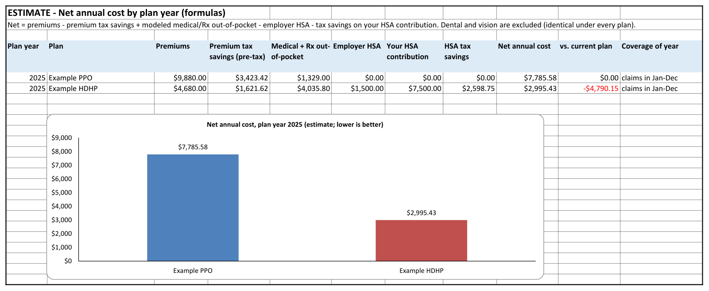

# Demo: a fictional family's year, end to end

One command runs the whole toolkit on made-up data, from myCigna-style claim exports and EOB PDFs to the Excel comparison. Nothing here is real: the "Demo" family, providers, drugs, IDs and plans are fictional, and the generated PDFs are stamped *SYNTHETIC DEMO - not a Cigna document*.

```powershell
python demo\run_demo.py          # macOS/Linux: python demo/run_demo.py
```

It takes a few seconds and writes everything to `demo\output\` (gitignored, wiped on every run). Then open `demo\output\hsa_comparison_demo.xlsx` in Excel or LibreOffice.



## The family

A household of four on the example PPO in 2025, with ordinary use: no surgery or hospital stay.

| Member | Care in 2025 |
|---|---|
| Alex (adult) | Annual physical and lab work, one sick visit, one dermatology visit, a generic prescription every month |
| Blair (adult) | Two orthopedic visits, an MRI, annual physical |
| Casey (child) | Sick visit, urgent care, a lab test, well-child visit, a brand-name inhaler every two months, a dental filling |
| Drew (child) | Well-child visit, urgent care with an X-ray, a short antibiotic prescription |
| Everyone | Two dental cleanings |

That is 15 medical claims ($3,520 allowed), 19 prescription fills ($1,413 allowed) and 9 dental claims. Under the PPO the family owed $1,329 for medical care and prescriptions. Two medical claims have no EOB PDF, so the extractor flags them for review, as it would with real data.

The plans are the fictional ones in [plan_parameters.example.json](../plan_parameters/plan_parameters.example.json): a PPO with a $500 deductible and copays, and an HDHP with a $4,000 family deductible, $1,500 of employer HSA money and lower premiums.

## What the run shows

| Step | Command it runs | What to look for |
|---|---|---|
| 1. Synthetic inputs | `make_demo_data.py` | 3 claim CSVs, 13 EOB PDFs, a leak-terms file in `demo\output\inputs\` |
| 2. Extract | `cigna_eob_extract.py extract --quiet` | 41 of 43 rows auto-validated, 2 flagged `no_matching_eob_pdf` |
| 3. Review | (simulated) | The 2 flagged rows are approved. With real data you'd check them in myCigna first |
| 4. Finalize | `cigna_eob_extract.py finalize` | 43 de-identified rows in `claims_anonymized.csv`: months, amounts, categories and `Member_A`…`Member_D`. No names, providers, drugs, IDs or dates |
| 5. Leak scan | `leak_scan.py` | `PASS`: no input names, providers, drugs, Rx/claim numbers, dates, filenames or listed terms in the outputs |
| 6. Validate plans | `validate_plan_parameters.py` | `VALID` |
| 7. Compare | `hsa_cost_model.py` | Baseline check: the replay of the PPO reproduces the $1,329 the family owed (100%, PASS) |

## The result

| | Example PPO | Example HDHP |
|---|---:|---:|
| Premiums | $9,880 | $4,680 |
| − Tax saved on pre-tax premiums | $3,423 | $1,622 |
| + Medical and Rx out-of-pocket (replayed) | $1,329 | $4,036 |
| − Employer HSA money | $0 | $1,500 |
| − Tax saved on your HSA contribution ($7,500) | $0 | $2,599 |
| **Net annual cost** | **$7,786** | **$2,995** |

For this family the HDHP costs about **$4,790 less**. They pay $2,707 more at the doctor and pharmacy, but premiums are $5,200 lower, and the employer's HSA money and the tax break on contributions more than cover the difference. With these example plans the HDHP also wins in the workbook's high-use and worst-case scenarios. **Your plans and your claims can give the opposite answer**; that is why the tool replays your own history.

Things to try in the workbook:

- **Parameters** (yellow cells): set your HSA contribution to $0 or change the tax rates. The **Annual comparison** chart updates.
- **Scenarios**, **Break-even**, **Cash flow** and **Projection** show what happens in a bad year, month by month, and over five years.
- **Claims replay** shows every claim under both plans.

## Try it with an AI agent (the skill's demo mode)

`run_demo.py` shows the result. To see the guided experience, ask an agent that supports Agent Skills to run the [hsa-plan-decision skill](../.github/skills/hsa-plan-decision/SKILL.md) on this family: GitHub Copilot in VS Code or the Copilot CLI, or Claude Code. Open the repository in the agent and ask:

> *"Walk me through the HSA decision with the demo family."*

The agent runs the same five phases it would with your data, in about 10-15 minutes:

1. **Interview:** the family's answers are pre-filled as defaults. Accept them, or change one (say, your state tax rate or HSA contribution) and watch it carry through.
2. **Plans:** it reads the fictional benefits summary and checks the plan-parameters file against it.
3. **Claims:** it extracts the synthetic claims, goes through the two flagged rows with you, and runs the leak scan.
4. **Comparison:** it runs the cost model and checks the baseline.
5. **Result:** it explains the workbook, then tells you what to gather for a run on your own data.

It follows the same privacy protocol as a real run, for example never opening the claim files. The files go to `demo/output/`, not `.local/`. The steps are in [demo-mode.md](../.github/skills/hsa-plan-decision/references/demo-mode.md).

## Run it on your own data

Follow the [Quick start](../README.md#quick-start-windows-powershell) with your files in `.local\`, or let the [hsa-plan-decision skill](../.github/skills/hsa-plan-decision/SKILL.md) walk you through it.

## For maintainers

- `demo\tests\test_demo.py` runs the demo and pins the net costs above. If a change moves them, regenerate the screenshot and update the figures in this file, the top-level README and the skill's [demo-mode.md](../.github/skills/hsa-plan-decision/references/demo-mode.md).
- Regenerate the screenshot (Windows with Microsoft Excel):

  ```powershell
  python demo\run_demo.py
  python demo\make_screenshot.py
  ```

  Excel recalculates the workbook, exports **Annual comparison** to PDF, and PyMuPDF renders `docs\images\demo-annual-comparison.png`. It also saves `demo\output\hsa_comparison_demo_recalculated.xlsx` (formula results cached, so previewers show numbers); attach that file to GitHub releases. The script strips the local folder path and Office user and company names that Excel writes into the file. If your user name or home folder still appears anywhere in it, the script deletes the file and stops.
- The privacy guard allows only `docs/images/demo-*.png` images. Never put a screenshot of real data there.
